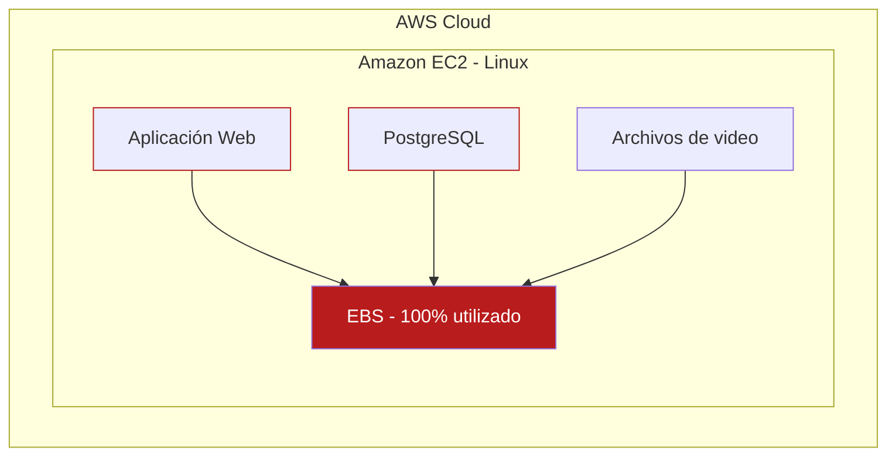

# Parte 1 — Diagnóstico y recuperación

## Contexto del incidente

A las 02:00 AM, un servidor de producción deja de responder.
La aplicación web no carga y PostgreSQL no acepta conexiones.

La infraestructura está alojada en AWS y cuenta con:

- Una instancia Linux.
- Una aplicación web.
- Una base de datos PostgreSQL.
- Almacenamiento de archivos de video.

Se detecta que el almacenamiento se encuentra al 100% de su capacidad.

## Supuestos técnicos

Para desarrollar la resolución se consideran los siguientes supuestos,
que deberán verificarse durante el diagnóstico:

- La instancia corresponde a Amazon EC2.
- El almacenamiento persistente utiliza Amazon EBS.
- Los servicios se ejecutan directamente sobre Linux.
- Existe acceso administrativo mediante SSH o AWS Systems Manager.
- Se desconoce la distribución Linux, el sistema de archivos y la
  distribución de los volúmenes.

## Objetivos

- Identificar el origen de la saturación del almacenamiento.
- Minimizar el tiempo de indisponibilidad.
- Preservar la integridad de los datos.
- Restablecer los servicios de manera segura.
- Implementar medidas preventivas para evitar recurrencias.


## Arquitectura actual



## 1.1. Secuencia de diagnóstico

La prioridad inicial es identificar el volumen afectado, determinar
qué está consumiendo el almacenamiento y evaluar el impacto sobre
los servicios productivos.

Durante esta etapa evitaría eliminar archivos, reiniciar servicios
o realizar cambios de infraestructura sin conocer previamente su impacto.

### Paso 1 — Verificar el estado de la infraestructura AWS

Desde la consola de AWS revisaría:

- Estado de la instancia EC2.
- System Status Checks e Instance Status Checks.
- Métricas disponibles en CloudWatch.
- Actividad de los volúmenes EBS.
- Alarmas activas.
- Cambios recientes en infraestructura y despliegues.

Accedería a la instancia mediante AWS Systems Manager Session
Manager, si está disponible:

```bash
aws ssm start-session --target i-XXXXXXXX
```

Como alternativa, utilizaría SSH autorizado.

### Paso 2 — Verificar el estado general del servidor

```bash
uptime
free -h
top
```

Estos comandos permiten evaluar la carga del sistema, disponibilidad
de memoria y consumo de recursos por proceso.

El objetivo es determinar si existen problemas adicionales a la
saturación del almacenamiento.

### Paso 3 — Identificar el volumen afectado

```bash
df -hT
df -i
lsblk -f
findmnt
```

| Comando | Objetivo |
|---------|----------|
| `df -hT` | Verificar capacidad y tipo de filesystem. |
| `df -i` | Detectar agotamiento de inodos. |
| `lsblk -f` | Identificar discos, particiones y filesystems. |
| `findmnt` | Identificar los puntos de montaje. |

Esto permite determinar si el problema afecta al volumen raíz,
al almacenamiento de PostgreSQL o al almacenamiento de videos.

### Paso 4 — Identificar los directorios de mayor consumo

Si el filesystem afectado corresponde al volumen raíz:

```bash
sudo du -xhd1 / 2>/dev/null | sort -hr
```

Profundizaría sobre los directorios que presenten mayor consumo:

```bash
sudo du -xhd1 /var | sort -hr
sudo du -xhd1 /var/lib | sort -hr
sudo du -xhd1 /var/log | sort -hr
sudo du -xhd1 /opt | sort -hr
```

Si el volumen afectado corresponde a otro punto de montaje,
realizaría el análisis directamente sobre ese filesystem.

Buscaría también archivos individuales de gran tamaño:

```bash
sudo find / -xdev -type f -size +1G \
  -printf '%s %p\n' 2>/dev/null | sort -nr
```

Las posibles causas incluyen:

- Acumulación de archivos de video.
- Logs sin políticas de rotación.
- Backups almacenados localmente.
- Archivos temporales.
- Crecimiento de PostgreSQL o sus archivos WAL.

Limitaría las búsquedas al volumen afectado para reducir el
impacto de operaciones intensivas de lectura sobre producción.

### Paso 5 — Detectar archivos eliminados que continúan abiertos

```bash
sudo lsof +L1
```

Un archivo eliminado puede continuar ocupando espacio mientras
un proceso mantenga abierto su descriptor.

Este escenario explicaría posibles diferencias entre el espacio
reportado por `df` y el calculado mediante `du`.

### Paso 6 — Verificar el estado de los servicios

```bash
sudo systemctl --failed
sudo systemctl status postgresql
sudo ss -lntp
```

Consultaría los logs recientes:

```bash
sudo journalctl -u postgresql --since "2 hours ago"
sudo journalctl -p err --since "2 hours ago"
```

También verificaría la disponibilidad de PostgreSQL:

```bash
pg_isready -h localhost -p 5432
```

Buscaría errores asociados a:

- No space left on device.
- Fallos de escritura.
- Conexiones rechazadas.
- Errores de inicialización.
- Problemas relacionados con WAL.

Repetiría el análisis sobre los servicios reales de la aplicación
web y el procesamiento de videos.

### Paso 7 — Determinar si el almacenamiento continúa creciendo

```bash
watch -n 5 df -h
```

Si las herramientas están disponibles, analizaría también
la actividad de escritura por proceso:

```bash
sudo iotop -o
```

El objetivo es determinar si existe un proceso que continúa
generando archivos y agravando el incidente.

### Resultado esperado

Al finalizar el diagnóstico debería contar con:

- Identificación del volumen saturado.
- Identificación de los principales consumidores de almacenamiento.
- Estado de PostgreSQL y de la aplicación web.
- Identificación de procesos que continúan generando datos.
- Evidencia de los errores registrados.
- Una hipótesis fundamentada sobre el origen del incidente.

Con esta información definiría la estrategia de contención
y recuperación del servicio, evitando acciones que puedan
comprometer la integridad de los datos.


## 1.2. Restablecimiento del servicio

Una vez identificada la causa de la saturación del almacenamiento,
la prioridad sería recuperar la disponibilidad de los servicios
en el menor tiempo posible, preservando la integridad de los datos.

La estrategia se divide en cinco etapas: contención, protección
de datos, recuperación de capacidad, restablecimiento de servicios
y validación.

### Paso 1 — Contención del incidente

Notificaría al responsable de guardia y registraría el inicio
del incidente, su impacto y los servicios afectados.

Identificaría si existe algún proceso que continúa generando
archivos o consumiendo almacenamiento.

Si el procesamiento de videos es el responsable, evaluaría
pausar temporalmente dicho servicio de manera controlada,
preservando los trabajos pendientes y evitando la pérdida
de nuevos archivos.

```bash
sudo systemctl status video-processor
sudo systemctl stop video-processor
```

El nombre del servicio es ilustrativo y deberá reemplazarse
por el correspondiente a la infraestructura real.

Si no es posible garantizar la conservación de los datos
entrantes, coordinaría previamente una estrategia de buffering,
reintentos o mantenimiento controlado.

No reiniciaría indiscriminadamente la instancia ni eliminaría
archivos sin conocer su función.

### Paso 2 — Protección de los datos

Antes de realizar modificaciones sobre el almacenamiento,
verificaría la disponibilidad de backups existentes y,
si las condiciones operativas lo permiten, generaría un
snapshot del volumen EBS afectado.

```bash
aws ec2 create-snapshot \
  --volume-id vol-XXXXXXXX \
  --description "Pre-recovery snapshot - disk full incident"
```

Registraría el identificador del snapshot y su estado.

```bash
aws ec2 describe-snapshots \
  --snapshot-ids snap-XXXXXXXX
```

Siempre que sea posible, pausaría las escrituras antes de
generar el snapshot para mejorar su consistencia.

Un snapshot de EBS realizado sobre un sistema activo no
garantiza por sí solo consistencia a nivel de aplicación.
Si PostgreSQL utiliza varios volúmenes, evaluaría snapshots
coordinados de todos los volúmenes involucrados.

El snapshot constituye una medida adicional de protección,
pero no reemplaza una estrategia de backups de PostgreSQL.

Evitaría especialmente:

- Eliminar archivos del directorio de datos de PostgreSQL.
- Eliminar manualmente archivos WAL.
- Eliminar videos sin verificar su retención y respaldo.
- Ejecutar operaciones destructivas sobre el filesystem.
- Restaurar backups sobre los datos originales sin validación.

### Paso 3 — Recuperar la capacidad de almacenamiento

Priorizaría ampliar el volumen EBS afectado, siempre que
sea compatible con Elastic Volumes y que los límites
operativos y las autorizaciones lo permitan.

Esta estrategia permite recuperar espacio sin necesidad
de eliminar información existente.

#### 3.1. Identificar el volumen

Desde AWS CLI verificaría los volúmenes asociados a la instancia.

```bash
aws ec2 describe-volumes \
  --filters Name=attachment.instance-id,Values=i-XXXXXXXX \
  --query 'Volumes[].{ID:VolumeId,Size:Size,Device:Attachments[0].Device,Type:VolumeType}' \
  --output table
```

Correlacionaría esta información con los dispositivos
y puntos de montaje de Linux.

```bash
lsblk -o NAME,SIZE,FSTYPE,MOUNTPOINT,SERIAL
df -hT
findmnt
```

#### 3.2. Ampliar el volumen EBS

Como ejemplo, si el volumen actual tiene 100 GiB,
podría ampliarlo a 150 GiB para recuperar capacidad
y disponer de margen operativo.

El tamaño definitivo dependerá del crecimiento observado,
la criticidad del servicio y los costos asociados.

```bash
aws ec2 modify-volume \
  --volume-id vol-XXXXXXXX \
  --size 150
```

Verificaría el progreso de la modificación:

```bash
aws ec2 describe-volumes-modifications \
  --volume-ids vol-XXXXXXXX \
  --output table
```

Una vez que la modificación se encuentre en estado
`optimizing` o `completed`, continuaría con la ampliación
del almacenamiento desde el sistema operativo.

#### 3.3. Extender la partición

Verificaría que Linux reconoce la nueva capacidad.

```bash
lsblk
df -hT
```

Para un volumen NVMe particionado, un ejemplo sería:

```bash
sudo growpart /dev/nvme0n1 1
```

Si el volumen no utiliza particiones, este paso
no sería necesario.

Si growpart falla debido a la falta de espacio temporal,
liberaría únicamente espacio previamente identificado
como prescindible o utilizaría una alternativa segura.

#### 3.4. Extender el filesystem

El comando dependerá del tipo de filesystem identificado
durante el diagnóstico.

Para EXT4:

```bash
sudo resize2fs /dev/nvme0n1p1
```

Para XFS, suponiendo que el volumen está montado en `/`:

```bash
sudo xfs_growfs /
```

Estos comandos son alternativas según el filesystem,
no pasos que deban ejecutarse consecutivamente.

Si la infraestructura utiliza LVM, sería necesario
adaptar el procedimiento al volumen físico y lógico.

Finalmente, verificaría la nueva capacidad:

```bash
df -hT
df -i
lsblk
```

#### 3.5. Alternativa si no es posible ampliar EBS

Si la ampliación no está disponible o requiere más tiempo,
evaluaría las siguientes alternativas:

- Liberar archivos temporales previamente identificados.
- Archivar logs antiguos en almacenamiento externo.
- Cerrar de manera controlada procesos que mantienen
  abiertos archivos eliminados.
- Transferir archivos de video a Amazon S3, verificando
  su integridad y disponibilidad antes de eliminar
  las copias locales.

No eliminaría información productiva únicamente
para recuperar espacio de manera inmediata.

### Paso 4 — Restablecer los servicios

Una vez recuperada la capacidad del almacenamiento,
restablecería los servicios respetando sus dependencias.

#### 4.1. PostgreSQL

Verificaría primero el estado de la base de datos.

```bash
sudo systemctl status postgresql
sudo journalctl -u postgresql -n 100 --no-pager
```

Si PostgreSQL se encuentra detenido, iniciaría el servicio.

```bash
sudo systemctl start postgresql
```

Verificaría que acepta conexiones:

```bash
pg_isready -h localhost -p 5432
```

Realizaría una consulta para comprobar su funcionamiento:

```bash
sudo -u postgres psql \
  -v ON_ERROR_STOP=1 \
  -c "SELECT NOW(), pg_is_in_recovery();"
```

Revisaría los logs durante el proceso de recuperación.

```bash
sudo journalctl -u postgresql -f
```

En caso de una interrupción inesperada, permitiría que
PostgreSQL realice su mecanismo de crash recovery
mediante los archivos WAL.

No intentaría forzar su inicialización eliminando
archivos internos o reiniciando repetidamente el servicio.

Si existen evidencias de corrupción o la recuperación
automática falla, escalaría el incidente y evaluaría una
restauración en un entorno separado utilizando backups
y Point-in-Time Recovery, si está disponible.

#### 4.2. Aplicación web

Una vez validado PostgreSQL, comprobaría el estado
de la aplicación web.

```bash
sudo systemctl status web-app
```

Si se encuentra detenida:

```bash
sudo systemctl start web-app
```

Verificaría los puertos y los logs de la aplicación.

```bash
sudo ss -lntp
sudo journalctl -u web-app -n 100 --no-pager
```

Si existe un endpoint de health check:

```bash
curl --fail --show-error \
  --max-time 10 \
  http://localhost:8080/health
```

También comprobaría su disponibilidad desde el punto
de acceso utilizado por los usuarios.

#### 4.3. Procesamiento de videos

Restablecería el procesamiento de videos de manera gradual,
una vez confirmado que PostgreSQL y la aplicación
funcionan correctamente.

```bash
sudo systemctl start video-processor
sudo systemctl status video-processor
sudo journalctl -u video-processor -n 100 --no-pager
```

Verificaría que los archivos pendientes pueden procesarse
correctamente y que no se produce nuevamente un
crecimiento descontrolado del almacenamiento.

### Paso 5 — Validación de la recuperación

Antes de considerar resuelto el incidente, comprobaría:

- Disponibilidad de la aplicación web.
- Conectividad y funcionamiento de PostgreSQL.
- Operaciones controladas de lectura y escritura.
- Disponibilidad e integridad de los archivos de video.
- Recuperación de trabajos pendientes.
- Ausencia de errores críticos en los logs.
- Estabilidad del consumo de almacenamiento.
- Funcionamiento desde la perspectiva del usuario.

Mantendría un monitoreo reforzado durante la recuperación.

```bash
watch -n 5 df -h
```

Complementaría esta verificación con las métricas y
alarmas disponibles en Amazon CloudWatch.

Registraría los tiempos de recuperación, los cambios
realizados y las evidencias obtenidas.

### Consideraciones sobre rollback y recuperación

Un rollback sería apropiado si el diagnóstico demuestra
que un despliegue reciente provocó el crecimiento
anormal de archivos, logs o datos.

Sin embargo, volver a una versión anterior de la aplicación
no recupera necesariamente el espacio ocupado.

Por lo tanto, la estrategia principal para este incidente
sería contener la causa, recuperar capacidad de
almacenamiento y restablecer los servicios.

La restauración de backups quedaría reservada para
situaciones donde exista corrupción o pérdida de datos,
evaluando previamente el impacto sobre el RPO y el RTO.

### Resultado esperado

- Capacidad de almacenamiento recuperada.
- PostgreSQL operativo.
- Aplicación web disponible.
- Procesamiento de videos restablecido.
- Datos existentes preservados y validados.
- Evidencias y acciones de recuperación documentadas.

La recuperación se considerará completa cuando los
servicios estén operativos y se haya verificado la
integridad de la información, no únicamente cuando
la instancia vuelva a responder.
