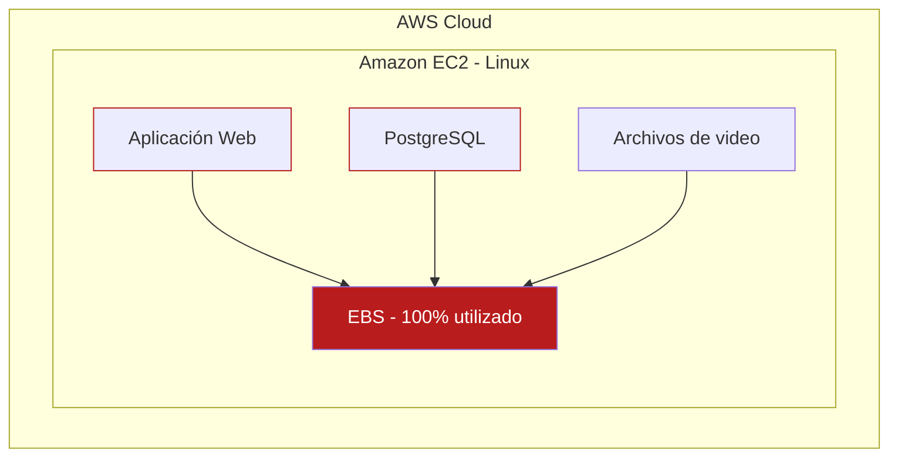
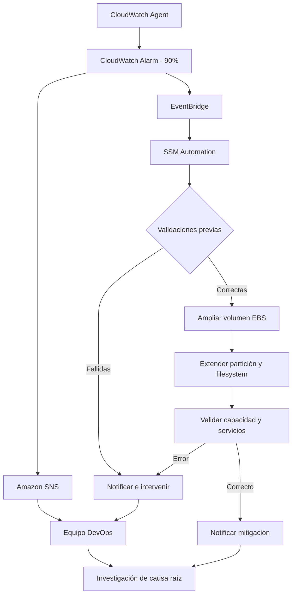

# Parte 1 — Diagnóstico y recuperación

## Contexto del incidente

A las 02:00 AM, un servidor de producción deja de responder.
La aplicación web no carga y PostgreSQL no acepta conexiones.

La infraestructura está alojada en AWS y cuenta con:

- Una instancia Linux.
- Una aplicación web.
- Una base de datos PostgreSQL.
- Almacenamiento de archivos de video.

Se detecta que el almacenamiento se encuentra al 100% de su capacidad.

## Supuestos técnicos

Para desarrollar la resolución se consideran los siguientes supuestos,
que deberán verificarse durante el diagnóstico:

- La instancia corresponde a Amazon EC2.
- El almacenamiento persistente utiliza Amazon EBS.
- Los servicios se ejecutan directamente sobre Linux.
- Existe acceso administrativo mediante SSH o AWS Systems Manager.
- Se desconoce la distribución Linux, el sistema de archivos y la distribución de los volúmenes.
- El diagrama de arquitectura representa un escenario hipotético en el que los servicios comparten almacenamiento.
Esta distribución deberá verificarse durante el diagnóstico.

## Objetivos

- Identificar el origen de la saturación del almacenamiento.
- Minimizar el tiempo de indisponibilidad.
- Preservar la integridad de los datos.
- Restablecer los servicios de manera segura.
- Implementar medidas preventivas para evitar recurrencias.


## Arquitectura actual



## 1.1. Secuencia de diagnóstico

La prioridad inicial es identificar el volumen afectado, determinar
qué está consumiendo el almacenamiento y evaluar el impacto sobre
los servicios productivos.

Durante esta etapa evitaría eliminar archivos, reiniciar servicios
o realizar cambios de infraestructura sin conocer previamente su impacto.

### Paso 1 — Verificar el estado de la infraestructura AWS

Desde la consola de AWS revisaría:

- Estado de la instancia EC2.
- System Status Checks e Instance Status Checks.
- Métricas disponibles en CloudWatch.
- Actividad de los volúmenes EBS.
- Alarmas activas.
- Cambios recientes en infraestructura y despliegues.

Accedería a la instancia mediante AWS Systems Manager Session
Manager, si está disponible:

```bash
aws ssm start-session --target i-XXXXXXXX
```

Como alternativa, utilizaría SSH autorizado.

### Paso 2 — Verificar el estado general del servidor

```bash
uptime
free -h
top
```

Estos comandos permiten evaluar la carga del sistema, disponibilidad
de memoria y consumo de recursos por proceso.

El objetivo es determinar si existen problemas adicionales a la
saturación del almacenamiento.

### Paso 3 — Identificar el volumen afectado

```bash
df -hT
df -i
lsblk -f
findmnt
```

| Comando | Objetivo |
|---------|----------|
| `df -hT` | Verificar capacidad y tipo de filesystem. |
| `df -i` | Detectar agotamiento de inodos. |
| `lsblk -f` | Identificar discos, particiones y filesystems. |
| `findmnt` | Identificar los puntos de montaje. |

Esto permite determinar si el problema afecta al volumen raíz,
al almacenamiento de PostgreSQL o al almacenamiento de videos.

### Paso 4 — Identificar los directorios de mayor consumo

Si el filesystem afectado corresponde al volumen raíz:

```bash
sudo du -xhd1 / 2>/dev/null | sort -hr
```

Profundizaría sobre los directorios que presenten mayor consumo:

```bash
sudo du -xhd1 /var | sort -hr
sudo du -xhd1 /var/lib | sort -hr
sudo du -xhd1 /var/log | sort -hr
sudo du -xhd1 /opt | sort -hr
```

Si el volumen afectado corresponde a otro punto de montaje,
realizaría el análisis directamente sobre ese filesystem.

Buscaría también archivos individuales de gran tamaño:

```bash
sudo find / -xdev -type f -size +1G \
  -printf '%s %p\n' 2>/dev/null | sort -nr
```

Las posibles causas incluyen:

- Acumulación de archivos de video.
- Logs sin políticas de rotación.
- Backups almacenados localmente.
- Archivos temporales.
- Crecimiento de PostgreSQL o sus archivos WAL.

Limitaría las búsquedas al volumen afectado para reducir el
impacto de operaciones intensivas de lectura sobre producción.

### Paso 5 — Detectar archivos eliminados que continúan abiertos

```bash
sudo lsof +L1
```

Un archivo eliminado puede continuar ocupando espacio mientras
un proceso mantenga abierto su descriptor.

Este escenario explicaría posibles diferencias entre el espacio
reportado por `df` y el calculado mediante `du`.

### Paso 6 — Verificar el estado de los servicios

```bash
sudo systemctl --failed
sudo systemctl status postgresql
sudo ss -lntp
```

Consultaría los logs recientes:

```bash
sudo journalctl -u postgresql --since "2 hours ago"
sudo journalctl -p err --since "2 hours ago"
```

También verificaría la disponibilidad de PostgreSQL:

```bash
pg_isready -h localhost -p 5432
```

Buscaría errores asociados a:

- No space left on device.
- Fallos de escritura.
- Conexiones rechazadas.
- Errores de inicialización.
- Problemas relacionados con WAL.

Repetiría el análisis sobre los servicios reales de la aplicación
web y el procesamiento de videos.

### Paso 7 — Determinar si el almacenamiento continúa creciendo

```bash
watch -n 5 df -h
```

Si las herramientas están disponibles, analizaría también
la actividad de escritura por proceso:

```bash
sudo iotop -o
```

El objetivo es determinar si existe un proceso que continúa
generando archivos y agravando el incidente.

### Resultado esperado

Al finalizar el diagnóstico debería contar con:

- Identificación del volumen saturado.
- Identificación de los principales consumidores de almacenamiento.
- Estado de PostgreSQL y de la aplicación web.
- Identificación de procesos que continúan generando datos.
- Evidencia de los errores registrados.
- Una hipótesis fundamentada sobre el origen del incidente.

Con esta información definiría la estrategia de contención
y recuperación del servicio, evitando acciones que puedan
comprometer la integridad de los datos.


## 1.2. Restablecimiento del servicio

Una vez identificada la causa de la saturación del almacenamiento,
la prioridad sería recuperar la disponibilidad de los servicios
en el menor tiempo posible, preservando la integridad de los datos.

La estrategia se divide en cinco etapas: contención, protección
de datos, recuperación de capacidad, restablecimiento de servicios
y validación.

### Paso 1 — Contención del incidente

Notificaría al responsable de guardia y registraría el inicio
del incidente, su impacto y los servicios afectados.

Identificaría si existe algún proceso que continúa generando
archivos o consumiendo almacenamiento.

Si el procesamiento de videos es el responsable, evaluaría
pausar temporalmente dicho servicio de manera controlada,
preservando los trabajos pendientes y evitando la pérdida
de nuevos archivos.

```bash
sudo systemctl status video-processor
sudo systemctl stop video-processor
```

El nombre del servicio es ilustrativo y deberá reemplazarse
por el correspondiente a la infraestructura real.

Si no es posible garantizar la conservación de los datos
entrantes, coordinaría previamente una estrategia de buffering,
reintentos o mantenimiento controlado.

No reiniciaría indiscriminadamente la instancia ni eliminaría
archivos sin conocer su función.

### Paso 2 — Protección de los datos

Antes de realizar modificaciones sobre el almacenamiento,
verificaría la disponibilidad de backups existentes y,
si las condiciones operativas lo permiten, generaría un
snapshot del volumen EBS afectado.

```bash
aws ec2 create-snapshot \
  --volume-id vol-XXXXXXXX \
  --description "Pre-recovery snapshot - disk full incident"
```

Registraría el identificador del snapshot y su estado.

```bash
aws ec2 describe-snapshots \
  --snapshot-ids snap-XXXXXXXX
```

Siempre que sea posible, pausaría las escrituras antes de
generar el snapshot para mejorar su consistencia.

Un snapshot de EBS realizado sobre un sistema activo no
garantiza por sí solo consistencia a nivel de aplicación.
Si PostgreSQL utiliza varios volúmenes, evaluaría snapshots
coordinados de todos los volúmenes involucrados.

El snapshot constituye una medida adicional de protección,
pero no reemplaza una estrategia de backups de PostgreSQL.

Evitaría especialmente:

- Eliminar archivos del directorio de datos de PostgreSQL.
- Eliminar manualmente archivos WAL.
- Eliminar videos sin verificar su retención y respaldo.
- Ejecutar operaciones destructivas sobre el filesystem.
- Restaurar backups sobre los datos originales sin validación.

### Paso 3 — Recuperar la capacidad de almacenamiento

Priorizaría ampliar el volumen EBS afectado, siempre que
sea compatible con Elastic Volumes y que los límites
operativos y las autorizaciones lo permitan.

Esta estrategia permite recuperar espacio sin necesidad
de eliminar información existente.

#### 3.1. Identificar el volumen

Desde AWS CLI verificaría los volúmenes asociados a la instancia.

```bash
aws ec2 describe-volumes \
  --filters Name=attachment.instance-id,Values=i-XXXXXXXX \
  --query 'Volumes[].{ID:VolumeId,Size:Size,Device:Attachments[0].Device,Type:VolumeType}' \
  --output table
```

Correlacionaría esta información con los dispositivos
y puntos de montaje de Linux.

```bash
lsblk -o NAME,SIZE,FSTYPE,MOUNTPOINT,SERIAL
df -hT
findmnt
```

#### 3.2. Ampliar el volumen EBS

Como ejemplo, si el volumen actual tiene 100 GiB,
podría ampliarlo a 150 GiB para recuperar capacidad
y disponer de margen operativo.

El tamaño definitivo dependerá del crecimiento observado,
la criticidad del servicio y los costos asociados.

```bash
aws ec2 modify-volume \
  --volume-id vol-XXXXXXXX \
  --size 150
```

Verificaría el progreso de la modificación:

```bash
aws ec2 describe-volumes-modifications \
  --volume-ids vol-XXXXXXXX \
  --output table
```

Una vez que la modificación se encuentre en estado
`optimizing` o `completed`, continuaría con la ampliación
del almacenamiento desde el sistema operativo.

#### 3.3. Extender la partición

Verificaría que Linux reconoce la nueva capacidad.

```bash
lsblk
df -hT
```

Para un volumen NVMe particionado, un ejemplo sería:

```bash
sudo growpart /dev/nvme0n1 1
```

Si el volumen no utiliza particiones, este paso
no sería necesario.

Si growpart falla debido a la falta de espacio temporal,
liberaría únicamente espacio previamente identificado
como prescindible o utilizaría una alternativa segura.

#### 3.4. Extender el filesystem

El comando dependerá del tipo de filesystem identificado
durante el diagnóstico.

Para EXT4:

```bash
sudo resize2fs /dev/nvme0n1p1
```

Para XFS, suponiendo que el volumen está montado en `/`:

```bash
sudo xfs_growfs /
```

Estos comandos son alternativas según el filesystem,
no pasos que deban ejecutarse consecutivamente.

Si la infraestructura utiliza LVM, sería necesario
adaptar el procedimiento al volumen físico y lógico.

Finalmente, verificaría la nueva capacidad:

```bash
df -hT
df -i
lsblk
```

#### 3.5. Alternativa si no es posible ampliar EBS

Si la ampliación no está disponible o requiere más tiempo,
evaluaría las siguientes alternativas:

- Liberar archivos temporales previamente identificados.
- Archivar logs antiguos en almacenamiento externo.
- Cerrar de manera controlada procesos que mantienen
  abiertos archivos eliminados.
- Transferir archivos de video a Amazon S3, verificando
  su integridad y disponibilidad antes de eliminar
  las copias locales.

No eliminaría información productiva únicamente
para recuperar espacio de manera inmediata.

### Paso 4 — Restablecer los servicios

Una vez recuperada la capacidad del almacenamiento,
restablecería los servicios respetando sus dependencias.

#### 4.1. PostgreSQL

Verificaría primero el estado de la base de datos.

```bash
sudo systemctl status postgresql
sudo journalctl -u postgresql -n 100 --no-pager
```

Si PostgreSQL se encuentra detenido, iniciaría el servicio.

```bash
sudo systemctl start postgresql
```

Verificaría que acepta conexiones:

```bash
pg_isready -h localhost -p 5432
```

Realizaría una consulta para comprobar su funcionamiento:

```bash
sudo -u postgres psql \
  -v ON_ERROR_STOP=1 \
  -c "SELECT NOW(), pg_is_in_recovery();"
```

Revisaría los logs durante el proceso de recuperación.

```bash
sudo journalctl -u postgresql -f
```

En caso de una interrupción inesperada, permitiría que
PostgreSQL realice su mecanismo de crash recovery
mediante los archivos WAL.

No intentaría forzar su inicialización eliminando
archivos internos o reiniciando repetidamente el servicio.

Si existen evidencias de corrupción o la recuperación
automática falla, escalaría el incidente y evaluaría una
restauración en un entorno separado utilizando backups
y Point-in-Time Recovery, si está disponible.

#### 4.2. Aplicación web

Una vez validado PostgreSQL, comprobaría el estado
de la aplicación web.

```bash
sudo systemctl status web-app
```

Si se encuentra detenida:

```bash
sudo systemctl start web-app
```

Verificaría los puertos y los logs de la aplicación.

```bash
sudo ss -lntp
sudo journalctl -u web-app -n 100 --no-pager
```

Si existe un endpoint de health check:

```bash
curl --fail --show-error \
  --max-time 10 \
  http://localhost:8080/health
```

También comprobaría su disponibilidad desde el punto
de acceso utilizado por los usuarios.

#### 4.3. Procesamiento de videos

Restablecería el procesamiento de videos de manera gradual,
una vez confirmado que PostgreSQL y la aplicación
funcionan correctamente.

```bash
sudo systemctl start video-processor
sudo systemctl status video-processor
sudo journalctl -u video-processor -n 100 --no-pager
```

Verificaría que los archivos pendientes pueden procesarse
correctamente y que no se produce nuevamente un
crecimiento descontrolado del almacenamiento.

### Paso 5 — Validación de la recuperación

Antes de considerar resuelto el incidente, comprobaría:

- Disponibilidad de la aplicación web.
- Conectividad y funcionamiento de PostgreSQL.
- Operaciones controladas de lectura y escritura.
- Disponibilidad e integridad de los archivos de video.
- Recuperación de trabajos pendientes.
- Ausencia de errores críticos en los logs.
- Estabilidad del consumo de almacenamiento.
- Funcionamiento desde la perspectiva del usuario.

Mantendría un monitoreo reforzado durante la recuperación.

```bash
watch -n 5 df -h
```

Complementaría esta verificación con las métricas y
alarmas disponibles en Amazon CloudWatch.

Registraría los tiempos de recuperación, los cambios
realizados y las evidencias obtenidas.

### Consideraciones sobre rollback y recuperación

Un rollback sería apropiado si el diagnóstico demuestra
que un despliegue reciente provocó el crecimiento
anormal de archivos, logs o datos.

Sin embargo, volver a una versión anterior de la aplicación
no recupera necesariamente el espacio ocupado.

Por lo tanto, la estrategia principal para este incidente
sería contener la causa, recuperar capacidad de
almacenamiento y restablecer los servicios.

La restauración de backups quedaría reservada para
situaciones donde exista corrupción o pérdida de datos,
evaluando previamente el impacto sobre el RPO y el RTO.

### Resultado esperado

- Capacidad de almacenamiento recuperada.
- PostgreSQL operativo.
- Aplicación web disponible.
- Procesamiento de videos restablecido.
- Datos existentes preservados y validados.
- Evidencias y acciones de recuperación documentadas.

La recuperación se considerará completa cuando los
servicios estén operativos y se haya verificado la
integridad de la información, no únicamente cuando
la instancia vuelva a responder.


## 1.3. Estrategia de monitoreo y prevención

Para evitar la recurrencia del incidente, implementaría una
estrategia de monitoreo preventivo, automatización operativa
y gestión de capacidad.

El objetivo es detectar condiciones de riesgo antes de que
el almacenamiento alcance el 100% y comprometa la disponibilidad
de los servicios productivos.

### Paso 1 — Implementar monitoreo del sistema operativo

Instalaría Amazon CloudWatch Agent en las instancias EC2
para recolectar métricas del sistema operativo que no están
disponibles de manera predeterminada en CloudWatch.

Configuraría la recolección de métricas cada 60 segundos.

| Métrica | Objetivo |
|---------|----------|
| disk_used_percent | Porcentaje de almacenamiento utilizado. |
| disk_free | Espacio disponible en bytes. |
| disk_inodes_free | Cantidad de inodos disponibles. |
| diskio_write_bytes | Actividad de escritura. |
| mem_used_percent | Utilización de memoria RAM. |
| CPUUtilization | Utilización de CPU de la instancia. |

Las métricas de CPUUtilization se obtendrían directamente
del namespace AWS/EC2.

Las métricas de almacenamiento se recolectarían mediante
CloudWatch Agent en el namespace CWAgent.

Ejemplo de configuración del agente:

```json
{
  "agent": {
    "metrics_collection_interval": 60
  },
  "metrics": {
    "namespace": "CWAgent",
    "append_dimensions": {
      "InstanceId": "${aws:InstanceId}"
    },
    "metrics_collected": {
      "disk": {
        "measurement": [
          "used_percent",
          "free",
          "inodes_free"
        ],
        "resources": ["*"],
        "drop_device": true,
        "ignore_file_system_types": [
          "sysfs",
          "devtmpfs",
          "tmpfs",
          "overlay"
        ]
      },
      "diskio": {
        "measurement": [
          "write_bytes",
          "read_bytes"
        ],
        "resources": ["*"]
      },
      "mem": {
        "measurement": [
          "mem_used_percent"
        ]
      }
    }
  }
}
```

Asignaría a la instancia un IAM Role con los permisos
necesarios para publicar métricas y logs, evitando
credenciales AWS estáticas.

Verificaría el estado del agente:

```bash
sudo /opt/aws/amazon-cloudwatch-agent/bin/amazon-cloudwatch-agent-ctl \
  -a status
```

También comprobaría que las métricas se publican
correctamente en CloudWatch:

```bash
aws cloudwatch list-metrics \
  --namespace CWAgent \
  --metric-name disk_used_percent
```

### Paso 2 — Definir alarmas y umbrales preventivos

Configuraría alarmas independientes para cada filesystem
productivo, evitando utilizar únicamente un promedio
general de almacenamiento entre servidores.

Propondría inicialmente los siguientes umbrales:

| Severidad | Umbral | Evaluación | Destinatario | Acción |
|-----------|--------|------------|--------------|--------|
| Warning | >= 70% | 15 minutos | Equipo DevOps | Seguimiento preventivo |
| High | >= 80% | 5 minutos | Equipo DevOps | Investigación de capacidad |
| Critical | >= 90% | 2 minutos | DevOps / On-call | Ampliación automática controlada |
| Emergency | >= 95% | 1 minuto | DevOps / On-call | Intervención inmediata |

Cada alarma evaluaría períodos de 60 segundos,
requiriendo inicialmente la cantidad correspondiente
de períodos consecutivos sobre el umbral.

Los umbrales deberán ajustarse según la capacidad,
criticidad y velocidad de crecimiento de cada volumen.

Complementaría estas alarmas con:

- Espacio absoluto disponible en GiB.
- Porcentaje y cantidad de inodos disponibles.
- Velocidad de crecimiento del almacenamiento.
- Tiempo estimado hasta la saturación.
- Ausencia de métricas del agente.

Por ejemplo, generaría una alerta preventiva si la
tendencia de crecimiento indica que el volumen podría
saturarse durante las próximas 24 horas, aunque todavía
no haya alcanzado un umbral crítico.

La ausencia de métricas no deberá interpretarse como
un estado saludable de la infraestructura.

### Paso 3 — Implementar notificaciones y escalamiento

Utilizaría Amazon SNS para distribuir las notificaciones
generadas por CloudWatch Alarms.

Separaría las notificaciones según su severidad.

```text
infrastructure-warning
infrastructure-high
infrastructure-critical
```

Las alertas preventivas serían enviadas al correo o canal
de comunicación del equipo de infraestructura.

Las alertas críticas serían enviadas a un sistema de
gestión de guardias, como PagerDuty u otra herramienta
equivalente, notificando al ingeniero responsable.

Las alertas críticas serían enviadas al equipo DevOps
y, en caso de existir, al sistema de gestión de guardias
operativas utilizado por la organización.

Cada notificación debería permitir identificar:

- Instancia afectada.
- Ambiente.
- Punto de montaje.
- Métrica y valor registrado.
- Severidad.
- Fecha y hora.
- Enlace al dashboard.
- Runbook correspondiente.

También verificaría periódicamente que las notificaciones
lleguen correctamente a sus destinatarios.

### Paso 4 — Centralización y estructuración de logs

Implementaría una estrategia de logging centralizado mediante
Amazon CloudWatch Logs, recopilando información de la aplicación
web, PostgreSQL, el procesamiento de videos y el sistema operativo.

El objetivo es disponer de información suficiente para diagnosticar
incidentes, identificar patrones y correlacionar errores entre
los diferentes componentes de la infraestructura.

#### Structured Logging

Propondría utilizar logs estructurados en formato JSON
en las aplicaciones que permitan implementar este formato.

Cada evento debería incluir, cuando corresponda:

- Timestamp en UTC.
- Nivel de severidad.
- Ambiente de ejecución.
- Nombre del servicio.
- Identificador de instancia.
- Identificador de correlación.
- Código y descripción del error.
- Contexto de la operación.

Ejemplo de un error durante el procesamiento de videos:

```json
{
  "timestamp": "2026-11-27T02:00:15Z",
  "level": "ERROR",
  "environment": "production",
  "service": "video-processor",
  "instance_id": "i-0123456789",
  "event": "video_write_failed",
  "correlation_id": "req-8f21a",
  "error_code": "ENOSPC",
  "message": "No space left on device"
}
```

#### Organización de Log Groups

Separaría los Log Groups por ambiente y servicio.

```text
/bsmart/production/web-app
/bsmart/production/postgresql
/bsmart/production/video-processor
/bsmart/production/system
```

Utilizaría Log Streams para identificar el origen de
los eventos dentro de cada servicio.

#### Análisis de logs

Utilizaría CloudWatch Logs Insights para consultar,
filtrar y correlacionar eventos.

Por ejemplo, para identificar errores relacionados
con la saturación del almacenamiento:

```sql
fields @timestamp, service, instance_id, message
| filter error_code = "ENOSPC"
| sort @timestamp desc
| limit 100
```

También evaluaría implementar Metric Filters para
generar métricas y alarmas a partir de errores
recurrentes registrados en los logs.

#### Políticas de retención

Definiría períodos de retención iniciales según
el tipo de información almacenada.

| Tipo de log | Retención propuesta |
|-------------|---------------------|
| Aplicación web | 30 días |
| Procesamiento de videos | 30 días |
| PostgreSQL | 30 días |
| Sistema operativo | 30 días |
| Seguridad y auditoría | 90 días |

Estos valores deberán ajustarse a los requerimientos
operativos, legales y de seguridad de la organización.

#### Rotación de logs locales

Implementaría logrotate para evitar el crecimiento
indefinido de los archivos almacenados en las instancias.

```conf
/var/log/web-app/*.log {
    daily
    maxsize 100M
    rotate 7
    compress
    delaycompress
    missingok
    notifempty
}
```

Ajustaría la frecuencia de ejecución de logrotate y
el mecanismo de reapertura de archivos según la aplicación.

También configuraría los mecanismos de retención propios
de PostgreSQL y systemd-journald.

#### Seguridad y buenas prácticas

- Evitar registrar contraseñas, tokens y credenciales.
- Evitar registrar información sensible innecesaria.
- Restringir el acceso a logs mediante IAM.
- Configurar cifrado y políticas de retención.
- Evitar el uso permanente de DEBUG en producción.
- Monitorear el volumen de logs y sus costos.

La centralización de logs permitiría investigar incidentes
sin depender exclusivamente del acceso a la instancia afectada,
mientras que las políticas de rotación y retención ayudarían
a prevenir nuevos problemas de almacenamiento.

### Paso 5 — Automatización de capacidad y Self-Healing

Implementaría una estrategia de ampliación automatizada
del almacenamiento mediante Amazon EBS Elastic Volumes.

El objetivo es anticipar la saturación del almacenamiento
y mitigar automáticamente el riesgo de indisponibilidad,
sin depender exclusivamente de una intervención manual.

A diferencia del escalado horizontal de EC2 o ECS,
esta automatización incrementaría la capacidad del
volumen EBS existente.

#### Activación de la automatización

Cuando el filesystem alcance una ocupación del 90%
durante dos períodos consecutivos de 60 segundos,
CloudWatch ejecutaría dos acciones independientes:

1. Enviar una notificación crítica mediante Amazon SNS
   al equipo DevOps o al mecanismo de guardia existente.

2. Generar un evento que, mediante Amazon EventBridge,
   active un runbook de AWS Systems Manager Automation.

La automatización buscaría recuperar margen de
almacenamiento antes de que el servicio se vea afectado.

También consideraría alertas anticipadas basadas en la
velocidad de crecimiento, dado que un volumen podría
saturarse antes de completar la ampliación.

#### Flujo de automatización



#### Política de ampliación

Como política inicial, evaluaría incrementar la capacidad
del volumen en un 30%, ajustando dicho valor según la
velocidad de crecimiento y las características del servicio.

Por ejemplo:

- Capacidad inicial: 100 GiB.
- Espacio utilizado: 90 GiB.
- Capacidad después de la ampliación: 130 GiB.
- Ocupación resultante aproximada: 69%.

El porcentaje de ampliación sería configurable y estaría
limitado por la capacidad máxima definida para cada volumen.

#### Controles de seguridad y costos

Antes de ejecutar una ampliación, el runbook debería:

- Verificar que la instancia y el volumen sean correctos.
- Confirmar nuevamente la métrica de ocupación.
- Identificar el filesystem y el esquema de particionado.
- Verificar que el volumen esté autorizado para autoescalado.
- Comprobar que no exista una modificación EBS en curso.
- Respetar los límites de modificación establecidos por AWS.
- Validar la capacidad máxima permitida.
- Evitar ejecuciones simultáneas o duplicadas.
- Utilizar IAM Roles con mínimo privilegio.
- Registrar las acciones y resultados de la automatización.

La automatización utilizaría los procedimientos de
ampliación de EBS y filesystem definidos en la sección 1.2.

Si alguna validación falla, se notificaría al equipo
DevOps para realizar una intervención manual.

Inicialmente validaría el runbook en un entorno no
productivo y utilizaría aprobaciones manuales hasta
garantizar su funcionamiento.

#### Gestión del incidente posterior al escalado

Una ampliación automática exitosa no implica que la
causa del incidente haya sido resuelta.

Aunque la ocupación del almacenamiento vuelva a valores
normales, mantendría registrado el evento crítico para
investigar su origen.

Analizaría mediante CloudWatch Logs, Logs Insights
y las métricas históricas:

- Crecimiento anormal de archivos de video.
- Logs sin rotación.
- Errores de aplicación.
- Acumulación de archivos temporales.
- Crecimiento de PostgreSQL o de sus archivos WAL.
- Cambios recientes en la infraestructura.

También registraría:

- Instancia y volumen afectados.
- Capacidad anterior y posterior.
- Ocupación antes y después de la ampliación.
- Fecha y hora de ejecución.
- Resultado de las validaciones.
- Identificador de ejecución de SSM Automation.

El incidente no se consideraría cerrado únicamente
porque la alarma de CloudWatch vuelva al estado OK.

La ampliación automática constituye una medida de
mitigación preventiva, mientras que el análisis de
causa raíz permite evitar nuevas recurrencias.

El objetivo es garantizar continuidad operativa
sin ocultar problemas estructurales ni generar un
crecimiento descontrolado de los costos.


### Paso 6 — Desacoplar el almacenamiento de videos

Considerando que la plataforma almacena archivos de video,
evaluaría migrar su almacenamiento persistente a Amazon S3.

Mantendría únicamente los archivos temporales necesarios
para el procesamiento dentro de las instancias EC2.

Implementaría:

- Cifrado de objetos.
- Bloqueo de acceso público.
- Acceso mediante IAM Roles.
- Políticas de retención.
- Lifecycle Policies.
- Validación de integridad de los archivos.
- Eliminación controlada de copias temporales.

Como ejemplo de política de almacenamiento:

| Antigüedad | Clase de almacenamiento |
|------------|------------------------|
| 0 a 30 días | S3 Standard |
| 30 a 90 días | S3 Standard-IA |
| Más de 90 días | S3 Glacier Flexible Retrieval |

Estas transiciones son ilustrativas y deberán ajustarse
a los requerimientos de acceso, conservación, recuperación
y costos de la plataforma.

No eliminaría la copia local de un archivo hasta
confirmar que fue almacenado correctamente en S3.

### Paso 7 — Mejorar la arquitectura y escalabilidad

A mediano plazo, evaluaría separar los componentes
actualmente alojados en la instancia EC2.

La arquitectura propuesta incluiría:

- Amazon RDS para PostgreSQL.
- Amazon S3 para almacenamiento de videos.
- Amazon SQS para desacoplar trabajos de procesamiento.
- EC2 o ECS para ejecutar aplicaciones y workers.
- Application Load Balancer para distribuir tráfico.
- Auto Scaling para adaptar la capacidad de procesamiento.

Cada componente tendría su propia estrategia de escalado.

| Componente | Estrategia |
|------------|------------|
| Aplicación web y API | CPU, memoria o solicitudes por target. |
| Procesamiento de videos | Backlog de SQS por consumidor. |
| PostgreSQL | RDS Storage Auto Scaling con límite máximo. |
| Almacenamiento de videos | Capacidad administrada de S3. |
| Volúmenes EBS | Monitoreo y ampliación controlada. |

Esta separación reduciría el impacto de una falla
de almacenamiento sobre el resto de los servicios.

### Paso 8 — Capacity Planning y validación

Implementaría dashboards de CloudWatch que permitan
visualizar el crecimiento histórico del almacenamiento.

Realizaría revisiones periódicas de capacidad considerando:

- Crecimiento diario y semanal.
- Volumen de videos almacenados.
- Capacidad disponible.
- Tiempo estimado hasta la saturación.
- Costos de almacenamiento.
- Crecimiento esperado de la plataforma.

Complementaría estas medidas con backups automatizados
de los datos persistentes y pruebas periódicas de restauración.

Validaría las alarmas y procedimientos de recuperación
mediante pruebas controladas en ambientes no productivos.

### Resultado esperado

- Detección temprana de condiciones de saturación.
- Notificaciones oportunas al equipo DevOps.
- Mitigación automática de condiciones críticas.
- Investigación de incidentes incluso después de una recuperación automática exitosa.
- Reducción del tiempo medio de detección (MTTD).
- Reducción del tiempo medio de recuperación (MTTR).
- Crecimiento controlado del almacenamiento.
- Menor dependencia de intervención manual.
- Mayor disponibilidad y confiabilidad de los servicios.

La estrategia busca evolucionar desde una operación
reactiva hacia una operación preventiva, automatizada
y basada en métricas.

## 1.4. Análisis de incidentes recurrentes

Que el mismo tipo de incidente haya ocurrido cuatro veces
durante un año, en servidores diferentes, sugiere que
podríamos estar frente a un problema sistémico en la
gestión de la infraestructura y no únicamente ante
una falla puntual de almacenamiento.

Esto podría indicar que las acciones realizadas anteriormente
estuvieron orientadas a recuperar los servicios, pero no
necesariamente a identificar y corregir las causas raíz.

Sin embargo, no asumiría que los cuatro incidentes tuvieron
exactamente el mismo origen sin analizar sus antecedentes.

### Paso 1 — Identificar patrones comunes

Realizaría un análisis comparativo de los incidentes,
revisando las métricas históricas, los logs, las configuraciones
de los servidores y las acciones de recuperación realizadas.

Evaluaría las siguientes hipótesis:

| Posible problema | Impacto |
|------------------|---------|
| Falta de monitoreo preventivo | Detección tardía de la saturación. |
| Ausencia de políticas de retención | Crecimiento descontrolado de archivos. |
| Falta de Capacity Planning | Infraestructura insuficiente frente al crecimiento. |
| Configuraciones inconsistentes | Diferencias operativas entre servidores. |
| Infraestructura acoplada | Una falla afecta a múltiples servicios. |
| Falta de seguimiento de incidentes | Repetición de problemas anteriormente mitigados. |

El objetivo sería determinar si existe un patrón común
entre los servidores afectados y verificar si otros
servidores presentan las mismas condiciones de riesgo.

### Paso 2 — Root Cause Analysis (RCA)

Aplicaría un análisis de causa raíz para identificar
no solamente qué provocó el incidente, sino también
por qué los mecanismos preventivos no fueron suficientes.

Una metodología que utilizaría sería la de los cinco porqués.

Por ejemplo, considerando un escenario hipotético:

1. ¿Por qué dejó de funcionar la aplicación?
   Porque PostgreSQL dejó de aceptar conexiones.

2. ¿Por qué PostgreSQL dejó de funcionar?
   Porque no disponía de espacio suficiente para escribir.

3. ¿Por qué se agotó el almacenamiento?
   Porque los archivos de video crecieron sin un control adecuado.

4. ¿Por qué no se detectó el crecimiento a tiempo?
   Porque no existían alarmas preventivas adecuadas.

5. ¿Por qué otros servidores presentaron el mismo problema?
   Porque no existía una configuración operativa estandarizada
   que garantizara el monitoreo y la gestión del almacenamiento.

Este análisis es ilustrativo. Las conclusiones definitivas
deberán estar respaldadas por las evidencias recopiladas.

### Paso 3 — Estandarización de la infraestructura

Si el análisis confirma diferencias de configuración
o ausencia de controles preventivos, propondría establecer
una configuración base reutilizable para los servidores.

Utilizaría Terraform para el aprovisionamiento de
infraestructura y Ansible para la configuración
del sistema operativo.

Terraform permitiría estandarizar:

- Instancias EC2.
- Volúmenes EBS.
- IAM Roles.
- CloudWatch Alarms.
- SNS Topics.
- Políticas de backup.
- Tags de identificación de recursos.

Ansible permitiría estandarizar:

- Instalación y configuración de CloudWatch Agent.
- Rotación y retención de logs.
- Configuración de servicios.
- Permisos y configuraciones del sistema operativo.
- Herramientas de diagnóstico.

También revisaría la infraestructura existente para
identificar desviaciones respecto de la configuración
esperada (configuration drift).

El objetivo sería garantizar que tanto los servidores
existentes como los nuevos cuenten con los controles
operativos necesarios desde su aprovisionamiento.

### Paso 4 — Runbooks y documentación de incidentes

Documentaría procedimientos reutilizables para responder
a incidentes frecuentes de infraestructura.

Por ejemplo:

```text
runbooks/
├── disk-full.md
├── database-unavailable.md
├── ebs-volume-expansion.md
├── failed-deployment.md
└── backup-restore.md
```

Cada runbook incluiría:

- Condiciones de activación.
- Secuencia de diagnóstico.
- Comandos y procedimientos de recuperación.
- Consideraciones de seguridad.
- Criterios de validación.
- Alternativas ante fallos de recuperación.

También propondría realizar postmortems sin
culpabilización individual, documentando:

- Impacto del incidente.
- Línea temporal de los acontecimientos.
- Causa raíz y factores contribuyentes.
- Acciones de mitigación.
- Acciones correctivas y preventivas.
- Seguimiento de las mejoras acordadas con el equipo.

Esto permitiría transformar cada incidente en una
oportunidad de mejora para toda la infraestructura.

### Paso 5 — Seguimiento y mejora continua

Evaluaría la efectividad de las medidas implementadas
mediante indicadores operativos.

| Indicador | Objetivo |
|-----------|----------|
| MTTD | Reducir el tiempo medio de detección. |
| MTTR | Reducir el tiempo medio de recuperación del servicio. |
| Incidentes recurrentes | Reducir la repetición de problemas conocidos. |
| Cobertura de monitoreo | Verificar que todos los servidores relevantes estén monitoreados. |
| Ampliaciones automáticas de EBS | Identificar crecimientos anormales y necesidades de capacidad. |

Una ampliación automática exitosa, como la propuesta
en la sección 1.3, no debería considerarse una solución
definitiva al problema.

Cada ejecución del mecanismo de Self-Healing debería
quedar registrada y ser analizada para determinar si
responde a un crecimiento esperado del negocio o a
una condición anormal de la infraestructura.

Finalmente, validaría las acciones preventivas mediante
pruebas controladas y revisiones periódicas, verificando
que las mejoras se apliquen también a los servidores
que todavía no hayan presentado incidentes.

### Conclusión

La recurrencia de incidentes similares en servidores
diferentes sugiere la necesidad de revisar los procesos
de gestión, monitoreo y estandarización de infraestructura.

No limitaría la solución a ampliar el almacenamiento
cada vez que se produzca una saturación.

Buscaría combinar observabilidad, automatización,
Infrastructure as Code, análisis de causa raíz y
mejora continua para reducir tanto la frecuencia
de los incidentes como su impacto operativo.

El objetivo no es solamente recuperar los servicios
más rápido, sino evitar que el mismo problema vuelva
a comprometer la disponibilidad de la plataforma.

## Referencias técnicas

### Almacenamiento y recuperación

- [AWS — Amazon EBS Elastic Volumes](https://docs.aws.amazon.com/ebs/latest/userguide/ebs-modify-volume.html)
- [AWS — Extend the file system after resizing EBS](https://docs.aws.amazon.com/ebs/latest/userguide/recognize-expanded-volume-linux.html)
- [AWS — Create EBS Snapshots](https://docs.aws.amazon.com/ebs/latest/userguide/ebs-creating-snapshot.html)
- [PostgreSQL — Continuous Archiving and Point-in-Time Recovery](https://www.postgresql.org/docs/current/continuous-archiving.html)

### Monitoreo y observabilidad

- [AWS — CloudWatch Agent Metrics](https://docs.aws.amazon.com/AmazonCloudWatch/latest/monitoring/metrics-collected-by-CloudWatch-agent.html)
- [AWS — CloudWatch Agent Configuration](https://docs.aws.amazon.com/AmazonCloudWatch/latest/monitoring/CloudWatch-Agent-Configuration-File-Details.html)
- [AWS — CloudWatch Logs Insights](https://docs.aws.amazon.com/AmazonCloudWatch/latest/logs/CWL_QuerySyntax.html)

### Automatización y escalabilidad

- [AWS — CloudWatch Events in EventBridge](https://docs.aws.amazon.com/eventbridge/latest/ref/events-ref-monitoring.html)
- [AWS — Systems Manager Automation with EventBridge](https://docs.aws.amazon.com/systems-manager/latest/userguide/running-automations-event-bridge.html)
- [AWS — RDS Storage Auto Scaling](https://docs.aws.amazon.com/AmazonRDS/latest/UserGuide/USER_PIOPS.Autoscaling.html)