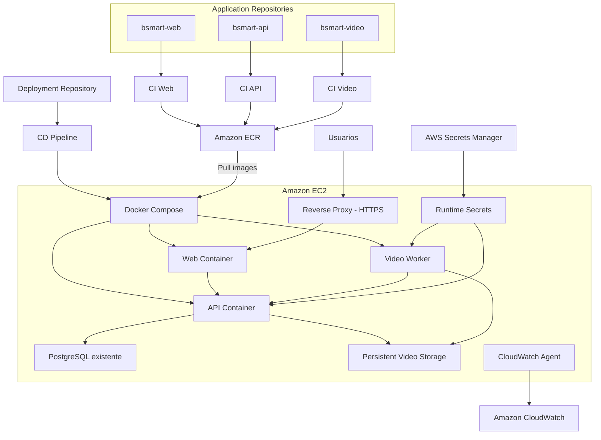
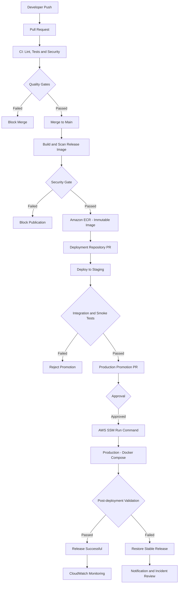

# Parte 2 — Diseño y automatización de despliegues

## Contexto

Actualmente la plataforma cuenta con tres servicios mantenidos
en repositorios independientes:

- Aplicación web.
- API.
- Servicio de procesamiento de video.

Los despliegues se realizan manualmente clonando el código
fuente directamente en el servidor productivo.

Este procedimiento puede generar inconsistencias entre ambientes,
dependencias no controladas, errores humanos y dificultades
para reproducir despliegues o recuperar versiones anteriores.

## Objetivos

- Estandarizar y automatizar los despliegues.
- Eliminar la necesidad de compilar código en producción.
- Garantizar la reproducibilidad de los despliegues.
- Reducir el impacto de los cambios entre servicios.
- Preservar la integridad y persistencia de los datos.
- Incorporar controles de seguridad y observabilidad.
- Facilitar la recuperación ante despliegues fallidos.

## 2.1. Esquema de despliegue con Docker

Propondría containerizar los tres servicios mediante Docker,
utilizando Docker Compose como mecanismo inicial de despliegue
sobre la infraestructura existente.

El objetivo es separar la construcción, distribución y ejecución
de las aplicaciones, permitiendo que el servidor productivo
ejecute imágenes previamente construidas y validadas.

### Supuestos técnicos

- La infraestructura productiva se encuentra alojada en AWS.
- Los servicios pueden ejecutarse sobre contenedores Linux.
- Se utilizará Amazon ECR como registro privado de imágenes.
- Se mantendrá inicialmente la infraestructura de datos existente.
- Los servicios pueden comunicarse mediante interfaces de red.
- Los puertos, endpoints de salud y variables de configuración
  son contratos de implementación propuestos que deberán
  adaptarse a las aplicaciones reales.

### Organización de repositorios

Mantendría los tres repositorios de aplicaciones existentes
y propondría un cuarto repositorio dedicado al despliegue.

```text
bsmart-web/
├── src/
├── tests/
├── Dockerfile
└── .dockerignore

bsmart-api/
├── src/
├── tests/
├── Dockerfile
└── .dockerignore

bsmart-video/
├── src/
├── tests/
├── Dockerfile
└── .dockerignore

bsmart-deployment/
├── docker-compose.yml
├── .env.example
├── environments/
│   ├── staging.env
│   └── production.env
├── scripts/
│   ├── deploy.sh
│   ├── rollback.sh
│   └── load-secrets.sh
└── docs/
```

Esta estructura representa una propuesta conceptual.

Cada repositorio de aplicación sería responsable de construir,
validar y publicar sus propias imágenes.

El repositorio de despliegue centralizaría la configuración,
las versiones de las imágenes y los procedimientos necesarios
para ejecutar los servicios.

Los archivos versionados contendrían únicamente configuración
no sensible.

Esto permitiría conocer exactamente qué versiones de cada
servicio componen una determinada release de la plataforma.

### Arquitectura propuesta



### Construcción de imágenes

Cada aplicación dispondría de su propio Dockerfile,
adaptado a su lenguaje y dependencias.

Implementaría:

- Multi-stage builds para separar compilación y ejecución.
- Imágenes base confiables y versionadas.
- Versiones controladas de dependencias.
- Usuarios sin privilegios de root.
- Archivos .dockerignore para excluir archivos innecesarios.
- Escaneo de vulnerabilidades mediante Trivy.
- Exclusión de secretos y credenciales durante el build.

Por ejemplo, un .dockerignore excluiría:

```text
.git
.env
.env.*
secrets/
*.pem
*.key
*.log
```

Las dependencias específicas del lenguaje también se excluirían
del contexto cuando corresponda.

La construcción se realizaría mediante pipelines CI/CD,
evitando instalar compiladores o dependencias de desarrollo
directamente en el servidor productivo.

### Registro y versionado de imágenes

Crearía tres repositorios independientes en Amazon ECR:

```text
bsmart-web
bsmart-api
bsmart-video
```

Cada imagen estaría identificada mediante el SHA del commit
que originó su construcción.

Por ejemplo:

```text
bsmart-web:git-a1b2c3d
bsmart-api:git-e4f5a6b
bsmart-video:git-c7d8e9f
```

Configuraría inmutabilidad de tags para evitar que una imagen
publicada pueda ser reemplazada accidentalmente por otra
con el mismo identificador.

Para producción utilizaría preferentemente referencias
mediante digest SHA256.

Esto garantizaría que el artefacto desplegado sea exactamente
el mismo que fue validado previamente.

Aplicaría el principio Build Once, Deploy Many, promoviendo
la misma imagen entre staging y producción sin reconstruirla.

También configuraría políticas de ciclo de vida en ECR
para controlar la acumulación de imágenes, preservando
las versiones necesarias para rollback.

### Configuración mediante Docker Compose

Docker Compose centralizaría la configuración de los tres
servicios y permitiría ejecutar la plataforma mediante
un procedimiento reproducible.

El archivo docker-compose.yml contemplaría:

- Referencias a imágenes versionadas en ECR.
- Redes independientes.
- Health checks.
- Políticas de reinicio.
- Límites de CPU y memoria.
- Almacenamiento persistente.
- Rotación de logs.
- Montaje de secretos por servicio.
- Apagado controlado de los procesos.

Los valores de configuración no sensibles se definirían
mediante variables de entorno.

El archivo .env.example documentaría las variables necesarias
sin incluir contraseñas ni tokens reales.

### Networking y comunicación entre servicios

Definiría dos redes Docker de tipo bridge:

| Red | Servicios |
|-----|-----------|
| frontend | Aplicación web y API |
| backend | API y procesamiento de video |

La aplicación web recibiría solicitudes externas mediante
un reverse proxy Nginx con HTTPS.

Publicaría el puerto de la aplicación web únicamente
sobre la interfaz local del servidor.

```text
127.0.0.1:8080
```

El reverse proxy sería el punto de entrada público.

La API y el procesador de video no tendrían puertos
publicados directamente en el host.

Los servicios se comunicarían mediante los nombres DNS
internos proporcionados por Docker Compose.

Por ejemplo:

```text
Web -> http://api:8000
Video Worker -> http://api:8000
```

La aplicación web utilizaría un proxy interno para redirigir
las solicitudes del navegador hacia la API.

De esta manera, los usuarios no necesitarían acceder
directamente a los nombres DNS internos de Docker.

Restringiría los puertos de entrada mediante Security Groups,
permitiendo únicamente las conexiones necesarias.

El acceso administrativo se realizaría preferentemente
mediante AWS Systems Manager Session Manager.

### Persistencia de datos

#### PostgreSQL

Mantendría inicialmente la base de datos existente,
evitando realizar una migración simultánea durante
la containerización de las aplicaciones.

Si PostgreSQL se ejecuta directamente sobre el servidor
EC2, configuraría una dirección accesible desde la red
de los contenedores.

Podría utilizar la referencia host.docker.internal
mediante el mapeo host-gateway en Docker Compose.

Configuraría PostgreSQL y pg_hba.conf para permitir
únicamente las conexiones requeridas desde la red
autorizada de la API.

No utilizaría localhost desde el contenedor para
conectarme a PostgreSQL en el host.

El puerto 5432 no estaría expuesto a Internet.

Mantendría backups automatizados de la base de datos
y validaría periódicamente su recuperación.

#### Archivos de video

Utilizaría un volumen EBS dedicado al almacenamiento
de videos, montado sobre una ruta específica del host.

Por ejemplo:

```text
/mnt/video-data/videos
```

Montaría esta ruta dentro de los contenedores que
necesiten acceder a los archivos.

```text
/data/videos
```

Antes de iniciar los servicios verificaría que el
volumen EBS esté montado correctamente.

```bash
findmnt --mountpoint /mnt/video-data
df -h /mnt/video-data
```

Si el almacenamiento no se encuentra disponible,
interrumpiría el despliegue.

Esto evitaría que los servicios comiencen a escribir
accidentalmente sobre el volumen raíz del servidor.

Los datos permanecerían disponibles aunque los
contenedores sean eliminados o reemplazados.

A mediano plazo evaluaría migrar el almacenamiento
persistente de videos a Amazon S3, utilizando cifrado,
Lifecycle Policies y validación de integridad antes
de eliminar las copias locales.

### Observabilidad y control de recursos

Configuraría health checks específicos para cada servicio.

| Servicio | Verificación propuesta |
|----------|------------------------|
| Web | Disponibilidad del endpoint HTTP de salud. |
| API | Estado de la aplicación y dependencias críticas. |
| Video Worker | Estado del proceso y capacidad de procesamiento. |

Utilizaría depends_on con service_healthy cuando un
servicio requiera que otro esté disponible durante
el arranque inicial.

Las aplicaciones también deberían implementar reintentos
controlados ante fallos temporales de sus dependencias.

Configuraría restart: unless-stopped para recuperar
procesos que terminen inesperadamente.

Un health check fallido no provoca automáticamente
el reinicio de un contenedor mediante Docker Compose.

Por este motivo, monitorearía el estado de salud
de los servicios y generaría alertas ante fallos
persistentes.

#### Límites de recursos

Definiría valores iniciales de referencia para evitar
que un servicio consuma todos los recursos del servidor.

| Servicio | CPU | Memoria |
|----------|-----|---------|
| Web | 0.5 vCPU | 512 MiB |
| API | 1 vCPU | 1 GiB |
| Video Worker | 2 vCPU | 4 GiB |

Estos valores son ilustrativos y deberán ajustarse
mediante métricas de utilización y pruebas de carga,
reservando capacidad para PostgreSQL y el sistema operativo.

El procesamiento de videos tendría especial consideración
debido a su potencial consumo de CPU, memoria y disco.

#### Gestión de logs

Las aplicaciones emitirían logs estructurados en JSON
mediante stdout y stderr.

Utilizaría el logging driver json-file de Docker
con rotación habilitada.

```yaml
logging:
  driver: json-file
  options:
    max-size: "20m"
    max-file: "5"
```

Esto limitaría el crecimiento de los logs administrados
por Docker a aproximadamente 100 MB por contenedor.

Utilizaría un recolector compatible, como Fluent Bit,
para centralizar los logs de los contenedores en
CloudWatch Logs.

Separaría los Log Groups por ambiente y servicio.

```text
/bsmart/production/web
/bsmart/production/api
/bsmart/production/video-worker
```

CloudWatch Agent continuaría recolectando las métricas
del sistema operativo, incluyendo almacenamiento,
memoria e inodos.

Mantendría alarmas preventivas sobre la ocupación
de los filesystems y enviaría notificaciones al
equipo DevOps mediante Amazon SNS.

### Seguridad y gestión de secretos

Almacenaría las credenciales de PostgreSQL, tokens de
API y claves de servicios externos en AWS Secrets Manager.

Separaría los secretos por ambiente y servicio.

Por ejemplo:

```text
/bsmart/production/api/database
/bsmart/production/api/worker-token
/bsmart/production/video/external-api-key
```

La instancia EC2 dispondría de un IAM Role con permisos
limitados para descargar imágenes de ECR y recuperar
los secretos necesarios para el despliegue.

No utilizaría Access Keys estáticas almacenadas
directamente en el servidor.

Un procedimiento de despliegue recuperaría los secretos
desde AWS Secrets Manager y los materializaría en archivos
temporales protegidos, preferentemente en un filesystem
respaldado por memoria.

Por ejemplo:

```text
/run/bsmart-secrets/
├── db_password
├── worker_api_token
└── external_api_key
```

Restringiría los permisos de los archivos según el UID/GID
del usuario de ejecución de cada contenedor.

Los secretos se proporcionarían mediante la funcionalidad
secrets de Docker Compose, montándolos como archivos
dentro de los contenedores autorizados.

Por ejemplo:

```text
API:
  /run/secrets/db_password
  /run/secrets/worker_api_token

Video Worker:
  /run/secrets/worker_api_token
  /run/secrets/external_api_key
```

La aplicación web no recibiría credenciales de PostgreSQL
ni claves de servicios externos.

Las aplicaciones deberán soportar la lectura de secretos
desde archivos, mediante variables como DB_PASSWORD_FILE
o un mecanismo equivalente.

Docker Compose montaría los archivos de secretos,
pero no reemplazaría a AWS Secrets Manager como
sistema centralizado de almacenamiento y rotación.

También aplicaría las siguientes medidas:

- Ejecutar los contenedores sin privilegios de root.
- Configurar no-new-privileges.
- Evitar contenedores privilegiados.
- No montar el socket de Docker dentro de las aplicaciones.
- Restringir el acceso de los contenedores al servicio
  de metadata de EC2 cuando no lo necesiten.
- Evitar registrar credenciales en logs.
- Escanear las imágenes antes de su publicación.
- Rotar periódicamente las credenciales.
- Auditar los accesos mediante AWS CloudTrail.

El acceso a Docker y al servidor productivo estaría
restringido a usuarios autorizados, dado que el acceso
administrativo al host permite acceder a los secretos
montados en los contenedores.

### Procedimiento de despliegue

El servidor productivo dispondría de Docker Engine,
Docker Compose y los permisos necesarios para acceder
a Amazon ECR.

Primero validaría la configuración, los secretos,
la conectividad con PostgreSQL y el almacenamiento.

```bash
docker compose --env-file environments/production.env \
  config --quiet
```

Después autenticaría Docker contra Amazon ECR.

```bash
aws ecr get-login-password --region us-east-1 \
  | docker login \
      --username AWS \
      --password-stdin \
      123456789012.dkr.ecr.us-east-1.amazonaws.com
```

Descargaría las imágenes correspondientes a la release.

```bash
docker compose --env-file environments/production.env pull
```

Ejecutaría los servicios sin realizar builds en producción.

```bash
docker compose --env-file environments/production.env \
  up -d --no-build --wait --wait-timeout 180
```

Finalmente verificaría el estado de los contenedores.

```bash
docker compose --env-file environments/production.env ps

docker compose --env-file environments/production.env \
  logs --tail 100

curl --fail http://127.0.0.1:8080/health

docker stats --no-stream
```

Complementaría estas verificaciones con pruebas funcionales
sobre la API y el procesamiento de videos.

Los identificadores de AWS, puertos y endpoints utilizados
son valores ilustrativos.

### Despliegues independientes

La separación de imágenes permitiría actualizar un
servicio sin reconstruir toda la plataforma.

Por ejemplo, ante una nueva versión de la API,
actualizaría su referencia en el archivo de configuración
de producción.

```bash
docker compose --env-file environments/production.env \
  pull api

docker compose --env-file environments/production.env \
  up -d --no-build --no-deps --wait api
```

Los otros contenedores continuarían ejecutándose
sin necesidad de reemplazarlos.

Antes del despliegue verificaría la compatibilidad
entre versiones y las migraciones de base de datos.

Si las validaciones posteriores fallan, recuperaría
la referencia de la última imagen estable y ejecutaría
nuevamente el despliegue del servicio afectado.

El rollback de una imagen no revierte automáticamente
las modificaciones realizadas sobre la base de datos.

Por ello, priorizaría migraciones compatibles con
versiones anteriores cuando sea posible.

### Limitaciones y evolución de la arquitectura

Docker Compose permite resolver el problema actual
sin incorporar inmediatamente una plataforma
de orquestación adicional.

Sin embargo, una única instancia EC2 continúa siendo
un punto único de falla.

Docker Compose tampoco proporciona por sí solo
escalado automático ni despliegues sin interrupciones.

Si el crecimiento y los requisitos de disponibilidad
lo justifican, evaluaría una evolución hacia:

- Amazon ECS para ejecutar y orquestar contenedores.
- Application Load Balancer para distribuir solicitudes.
- ECS Service Auto Scaling para ajustar la capacidad.
- Amazon RDS para administrar PostgreSQL.
- Amazon S3 para almacenar archivos de video.
- Amazon SQS para desacoplar el procesamiento de trabajos.

Esta evolución permitiría escalar los servicios de manera
independiente y reducir el impacto de fallos individuales.

La decisión se tomaría considerando métricas de utilización,
requisitos operativos y costos de infraestructura.

### Resultado esperado

- Despliegues reproducibles y versionados.
- Eliminación del clonado manual de código en producción.
- Independencia del ciclo de vida de cada servicio.
- Reducción del impacto de los despliegues.
- Mayor trazabilidad y capacidad de rollback.
- Persistencia de datos independiente de los contenedores.
- Gestión segura y centralizada de credenciales.
- Observabilidad y control de recursos desde el diseño.
- Reducción de riesgos asociados a errores operativos.


### Validación de la configuración

Se realizó una validación local del archivo Docker Compose
mediante los siguientes comandos:

```bash
docker compose --env-file .env.example config --quiet
docker compose --env-file .env.example config --services
```

Resultados obtenidos:

- Código de salida: 0.
- Configuración e interpolación de variables correctas.
- Servicios reconocidos: api, video-worker y web.

La validación corresponde a la configuración estática.
No se ejecutaron los contenedores debido a que las imágenes
de las aplicaciones y la infraestructura productiva no
forman parte del material proporcionado en el challenge.


---

## 2.2. Automatización del proceso desde el push hasta producción

### Estrategia propuesta

Implementaría un proceso de integración y entrega continua
(CI/CD) que permita construir, validar, distribuir y desplegar
las aplicaciones de manera automatizada y controlada.

Utilizaría GitHub Actions como plataforma de automatización,
Amazon ECR como registro de imágenes y AWS Systems Manager
como mecanismo de ejecución remota de los despliegues.

Mantendría Git como fuente de verdad de la configuración
y las versiones deseadas de cada ambiente.

La propuesta incorpora principios de GitOps mediante
configuración declarativa, versionado y cambios aprobados
a través de Pull Requests.

Inicialmente utilizaría un modelo push-based, donde el pipeline
inicia el despliegue, sin incorporar un agente adicional
de reconciliación continua.

Por este motivo, no constituye una implementación completa
de GitOps bajo los principios de OpenGitOps.

### Arquitectura del pipeline



### 1. Estrategia de branching y control de cambios

Utilizaría una estrategia de ramas de corta duración,
manteniendo main como rama principal estable.

Por ejemplo:

- main
- feat/video-processing
- fix/api-timeout
- hotfix/database-connection

Cada modificación se realizaría mediante un Pull Request.

Configuraría reglas de protección sobre main para:

- Impedir pushes directos no autorizados.
- Impedir force pushes.
- Exigir al menos una revisión independiente.
- Exigir la ejecución exitosa de los controles de CI.
- Invalidar aprobaciones cuando se incorporen nuevos cambios.
- Restringir modificaciones sobre pipelines y configuraciones
  críticas mediante CODEOWNERS.

No utilizaría un modelo de branching complejo si el tamaño
del equipo y la frecuencia de releases no lo justifican.

### 2. Continuous Integration (CI)

Cada repositorio de aplicación dispondría de su propio
pipeline, ejecutado ante pushes y Pull Requests.

Los controles dependerían del stack de cada servicio,
pero mantendría una estructura común.

| Control | Herramienta propuesta | Objetivo |
|---------|----------------------|----------|
| Lint y formato | Según lenguaje | Detectar errores y mantener consistencia. |
| Tests unitarios | Framework del proyecto | Validar la lógica de negocio. |
| Tests de integración | Según dependencias | Verificar interacciones entre componentes. |
| Análisis estático | SonarQube | Detectar problemas de calidad y seguridad. |
| Secret scanning | Gitleaks | Detectar credenciales incorporadas al código. |
| Dependency scanning | Trivy | Identificar dependencias vulnerables. |
| Docker build | Docker BuildKit | Validar la construcción de la aplicación. |

Los tests de integración utilizarían dependencias aisladas
y datos de prueba, sin acceder a la infraestructura productiva.

Centralizaría las etapas comunes mediante reusable workflows
para evitar duplicar la lógica de CI entre los repositorios.

Los workflows compartidos estarían versionados y sujetos
a revisiones antes de su modificación.

### 3. Quality Gates y Security Gates

No permitiría continuar con una release cuando los
controles obligatorios hayan fallado.

Definiría inicialmente los siguientes criterios:

- Todos los tests obligatorios deben finalizar correctamente.
- El Quality Gate de SonarQube debe ser aprobado.
- No deben detectarse credenciales expuestas.
- El Dockerfile debe construirse correctamente.
- No deben existir vulnerabilidades HIGH o CRITICAL
  sin una excepción de seguridad aprobada y vigente.

Los umbrales de cobertura y calidad se establecerían
considerando el estado real de los proyectos.

No definiría porcentajes arbitrarios sin conocer
la base de código existente.

Las excepciones de seguridad deberán contar con una
justificación, medidas de mitigación y fecha de vencimiento.

### 4. Construcción y publicación de imágenes

Una vez aprobado y mergeado el Pull Request,
el pipeline ejecutaría las validaciones correspondientes
sobre el commit definitivo de main.

Construiría la imagen Docker fuera de producción.

Por ejemplo, para la API:

```bash
IMAGE="123456789012.dkr.ecr.us-east-1.amazonaws.com/bsmart-api"
TAG="git-${GITHUB_SHA}"

docker build --tag "${IMAGE}:${TAG}" .
```

Escanearía la imagen construida antes de publicarla:

```bash
trivy image \
  --severity HIGH,CRITICAL \
  --exit-code 1 \
  "${IMAGE}:${TAG}"
```

Si la imagen supera los controles, el pipeline la
publicaría en Amazon ECR.

```bash
aws ecr get-login-password --region us-east-1 \
  | docker login \
      --username AWS \
      --password-stdin \
      123456789012.dkr.ecr.us-east-1.amazonaws.com

docker push "${IMAGE}:${TAG}"
```

Recuperaría el digest asociado a la imagen:

```bash
aws ecr describe-images \
  --repository-name bsmart-api \
  --image-ids imageTag="${TAG}" \
  --query 'imageDetails[0].imageDigest' \
  --output text
```

El digest sería utilizado para identificar de forma
inequívoca la imagen durante los despliegues.

La imagen publicada no sería reconstruida para producción.

Aplicaría Build Once, Deploy Many, promoviendo el mismo
artefacto entre los distintos ambientes.

Como evidencia del proceso conservaría:

- Commit SHA.
- Image digest.
- Resultados de tests.
- Reportes de calidad y vulnerabilidades.
- SBOM de la imagen.
- Identificador de ejecución del pipeline.

### 5. Seguridad y autenticación del pipeline

Utilizaría OpenID Connect (OIDC) entre GitHub Actions
y AWS IAM para obtener credenciales temporales mediante STS.

Evitaría almacenar AWS Access Keys de larga duración
dentro de GitHub Secrets.

Separaría los permisos según las responsabilidades:

| IAM Role | Permisos |
|----------|----------|
| CI Web | Publicación en ECR de la aplicación web. |
| CI API | Publicación en ECR de la API. |
| CI Video | Publicación en ECR del procesador de video. |
| CD Staging | Despliegue sobre infraestructura de staging. |
| CD Production | Despliegue sobre infraestructura productiva. |
| EC2 Runtime | Lectura de ECR y secretos autorizados. |

Restringiría las políticas de confianza de OIDC al
repositorio y rama o ambiente correspondiente.

Los jobs de validación de Pull Requests no tendrían
credenciales de producción.

Los repositorios de aplicaciones no tendrían permisos
para ejecutar despliegues directamente sobre producción.

También fijaría las versiones de las GitHub Actions
de terceros mediante commit SHA y aplicaría permisos
mínimos al GITHUB_TOKEN.

### 6. Actualización del repositorio de despliegue

Una vez publicada una imagen, el pipeline generaría
un Pull Request en el repositorio bsmart-deployment.

Utilizaría una GitHub App con permisos limitados
para automatizar la creación de estos Pull Requests,
evitando utilizar tokens personales de desarrolladores.

Por ejemplo, ante una nueva versión de la API,
se modificaría únicamente API_IMAGE en:

```text
environments/staging.env
```

La configuración de cada ambiente contendría las
referencias completas a las imágenes de los tres servicios.

Ejemplo conceptual:

```dotenv
WEB_IMAGE=registry/bsmart-web@sha256:<web-digest>
API_IMAGE=registry/bsmart-api@sha256:<api-digest>
VIDEO_IMAGE=registry/bsmart-video@sha256:<video-digest>
```

Los digests representan valores ilustrativos.

Este mecanismo permitiría conocer exactamente qué versiones
componen cada release y mantener un historial auditable
de los cambios de infraestructura y aplicaciones.

El Pull Request validaría también la configuración
de Docker Compose y las referencias de imágenes.

### 7. Despliegue y validación en staging

Dispondría de un ambiente staging aislado de producción,
con su propia configuración, base de datos y secretos.

Una vez aprobado el cambio de staging, desplegaría
automáticamente la nueva composición de servicios.

Ejecutaría las siguientes verificaciones:

- Health checks de los contenedores.
- Smoke tests de la aplicación web.
- Pruebas funcionales de la API.
- Conectividad con PostgreSQL.
- Procesamiento de un archivo de video de prueba.
- Compatibilidad entre las versiones desplegadas.
- Consumo de CPU, memoria y almacenamiento.
- Revisión de errores y logs.

Si alguna validación obligatoria falla, bloquearía
la promoción hacia producción.

Los datos productivos no se utilizarían directamente
para ejecutar estas pruebas.

### 8. Promoción hacia producción

Una vez validada la release en staging, generaría
un Pull Request que actualice:

```text
environments/production.env
```

La promoción utilizaría los mismos digests aprobados
durante las pruebas.

Validaría que la combinación completa de versiones
a desplegar sea la misma que fue probada en staging.

Si producción contiene una composición diferente,
revalidaría la combinación antes de promoverla.

Exigiría una aprobación independiente para los
despliegues productivos.

Utilizaría GitHub Environments con required reviewers
cuando el plan contratado permita esa funcionalidad.

Como alternativa, utilizaría un Pull Request de promoción
protegido, con revisión obligatoria y un workflow de
producción restringido al merge aprobado.

La aprobación sería manual, pero la ejecución del
despliegue y sus validaciones serían automatizadas.

### 9. Continuous Delivery (CD) mediante AWS Systems Manager

No utilizaría conexiones SSH iniciadas directamente
desde los runners de GitHub Actions.

Utilizaría AWS Systems Manager Run Command para ejecutar
procedimientos de despliegue sobre las instancias EC2.

Las instancias dispondrían de SSM Agent y los permisos
necesarios para operar como managed nodes.

El pipeline de CD:

1. Recuperaría la revisión aprobada del repositorio
   de despliegue.
2. Empaquetaría la configuración de la release.
3. Publicaría el artefacto en un bucket S3 privado,
   versionado y con cifrado habilitado.
4. Invocaría un documento SSM de despliegue autorizado.
5. Esperaría el resultado real de la ejecución remota.
6. Registraría el estado final del despliegue.

El artefacto estaría asociado al commit aprobado y a
un checksum para verificar su integridad.

El documento SSM utilizaría parámetros controlados
para identificar la release a desplegar.

Restringiría los permisos de ejecución del pipeline
al documento SSM específico y a las instancias
del ambiente correspondiente.

Evitaría conceder permisos generales para ejecutar
comandos arbitrarios sobre toda la infraestructura.

### 10. Verificaciones previas al despliegue

Antes de reemplazar los contenedores, el procedimiento
ejecutado en EC2 verificaría:

- Disponibilidad de las imágenes requeridas.
- Configuración válida de Docker Compose.
- Capacidad disponible de CPU y memoria.
- Espacio libre suficiente en los filesystems.
- Montaje correcto del volumen EBS de videos.
- Conectividad con PostgreSQL.
- Disponibilidad de los secretos.
- Compatibilidad de las migraciones de base de datos.
- Disponibilidad de la última release estable.

Por ejemplo:

```bash
docker compose \
  --env-file environments/production.env \
  config --quiet

findmnt --mountpoint /mnt/video-data

df -h /mnt/video-data
```

Si alguna condición crítica falla, interrumpiría el
despliegue sin reemplazar los contenedores activos.

No ejecutaría despliegues simultáneos sobre un mismo
ambiente.

Utilizaría concurrency groups en GitHub Actions y
un mecanismo de locking en el servidor, por ejemplo flock.

No cancelaría una ejecución que ya se encuentra
modificando la infraestructura productiva.

### 11. Ejecución del despliegue

El procedimiento recuperaría los secretos necesarios
desde AWS Secrets Manager utilizando el IAM Role de EC2.

Los archivos de secretos se prepararían en
/run/bsmart-secrets con permisos restringidos.

Después autenticaría Docker contra Amazon ECR
y descargaría las imágenes de la release aprobada.

```bash
docker compose \
  --env-file environments/production.env \
  pull
```

Ejecutaría la actualización utilizando las imágenes
previamente construidas:

```bash
docker compose \
  --env-file environments/production.env \
  up -d --no-build --wait --wait-timeout 180
```

Si el cambio afecta exclusivamente a un servicio,
y se ha validado su compatibilidad, utilizaría
un despliegue independiente.

```bash
docker compose \
  --env-file environments/production.env \
  pull api

docker compose \
  --env-file environments/production.env \
  up -d --no-build --no-deps --wait api
```

En ambos casos utilizaría el mismo nombre de proyecto
Compose para conservar la identidad del despliegue.

Si se modifican archivos de secretos, recrearía los
contenedores consumidores para garantizar que utilicen
las nuevas credenciales.

Para el procesador de video contemplaría un apagado
controlado, evitando perder trabajos en ejecución.

El worker deberá soportar interrupciones mediante
manejo de señales, reintentos y operaciones idempotentes.

Con una única instancia y una réplica por servicio,
este mecanismo puede generar interrupciones breves.

No asumiría que Docker Compose garantiza zero downtime.

### 12. Validación posterior al despliegue

Una ejecución exitosa de Docker Compose no garantiza
que la aplicación funcione correctamente.

Realizaría validaciones adicionales:

```bash
docker compose \
  --env-file environments/production.env ps

curl --fail http://127.0.0.1:8080/health

docker stats --no-stream
```

Ejecutaría pruebas funcionales no destructivas sobre
los endpoints críticos y el procesamiento de videos.

También verificaría métricas en CloudWatch:

- Tasa de errores HTTP.
- Latencia de la API.
- Consumo de CPU y memoria.
- Ocupación de almacenamiento.
- Reinicios de contenedores.
- Errores en trabajos de procesamiento.

Definiría inicialmente una ventana de observación
de 10 minutos, ajustable según la frecuencia de tráfico
y las características de cada aplicación.

Los umbrales se establecerían utilizando métricas
históricas y objetivos de disponibilidad del servicio.

Si las validaciones son satisfactorias, marcaría
la nueva release como estable.

### 13. Estrategia de rollback

Antes de cada despliegue conservaría la configuración
completa de la última release estable.

Esta configuración incluiría:

- Commit del repositorio de despliegue.
- Archivo Docker Compose correspondiente.
- Digests de las imágenes desplegadas.
- Configuración no sensible del ambiente.

Si la nueva versión falla durante el arranque,
las pruebas funcionales o la ventana de observación,
interrumpiría su promoción como release estable.

Cuando el rollback sea compatible con el estado de
los datos, restauraría automáticamente la última
configuración estable.

Por ejemplo:

```bash
docker compose \
  -f /opt/bsmart/releases/stable/docker-compose.yml \
  --env-file /opt/bsmart/releases/stable/production.env \
  pull

docker compose \
  -f /opt/bsmart/releases/stable/docker-compose.yml \
  --env-file /opt/bsmart/releases/stable/production.env \
  up -d --no-build --wait --wait-timeout 180
```

Volvería a ejecutar las validaciones posteriores
para confirmar la recuperación del servicio.

El rollback no requeriría reconstruir las imágenes,
ya que las versiones anteriores permanecerían en ECR.

Si la recuperación automática no resulta satisfactoria,
generaría una alerta crítica para intervención manual.

Una vez recuperado el servicio, revertiría el cambio
correspondiente en el repositorio de despliegue para
mantener consistencia entre Git y el estado real.

No eliminaría volúmenes persistentes ni ejecutaría
operaciones destructivas como parte de un rollback
de aplicaciones.

### 14. Migraciones de base de datos

El rollback de una imagen Docker no revierte
automáticamente las modificaciones sobre PostgreSQL.

Por este motivo, separaría las migraciones del proceso
de arranque normal de los contenedores.

Las migraciones serían versionadas, probadas en staging
y ejecutadas una única vez mediante un job controlado.

Priorizaría el patrón Expand and Contract:

1. Incorporar cambios compatibles con la versión existente.
2. Desplegar las aplicaciones que utilizan el nuevo esquema.
3. Migrar o completar los datos necesarios.
4. Eliminar estructuras anteriores en una release posterior.

Esto permitiría mantener compatibilidad temporal entre
las versiones anteriores y nuevas de las aplicaciones.

Ante migraciones irreversibles o incompatibles,
requeriría un procedimiento de recuperación específico
y aprobación adicional antes del despliegue.

No ejecutaría automáticamente migraciones inversas
que puedan provocar pérdida de información.

### 15. Trazabilidad y notificaciones

Registraría cada despliegue con la siguiente información:

- Identificador de la release.
- Commit de la aplicación.
- Digest de la imagen.
- Commit del repositorio de despliegue.
- Ambiente.
- Fecha y hora.
- Responsable de la aprobación.
- Resultado de los controles.
- Estado del despliegue.
- Resultado del rollback, si corresponde.

Centralizaría los registros operativos en CloudWatch Logs
y utilizaría Amazon SNS para notificar despliegues
fallidos, rollbacks e incidentes al equipo DevOps.

Evaluaría métricas DORA para medir la evolución
del proceso de entrega, incluyendo frecuencia de
despliegues, lead time y fallos asociados a cambios.

### 16. Evolución hacia GitOps

La arquitectura propuesta mantiene el estado deseado
de los ambientes versionado de manera declarativa.

Como evolución, podría incorporar un agente encargado
de recuperar periódicamente la configuración aprobada,
compararla con el estado real y reconciliar diferencias.

Esto permitiría avanzar hacia un modelo GitOps
pull-based con reconciliación continua.

También incorporaría mecanismos de detección de drift
para identificar modificaciones realizadas fuera de Git.

Si posteriormente se adopta Kubernetes, evaluaría
herramientas como Argo CD o Flux para implementar
este modelo de operación.

No incorporaría estas plataformas en la arquitectura
inicial sin una necesidad operativa que lo justifique.

### Resultado esperado

- Eliminación de despliegues manuales.
- Validaciones automáticas antes de producción.
- Imágenes inmutables y trazabilidad de releases.
- Separación de responsabilidades entre CI y CD.
- Autenticación mediante credenciales temporales.
- Promoción controlada entre ambientes.
- Reducción del riesgo asociado a cambios.
- Recuperación ante despliegues fallidos.
- Configuración declarativa versionada.
- Base preparada para una evolución hacia GitOps.
